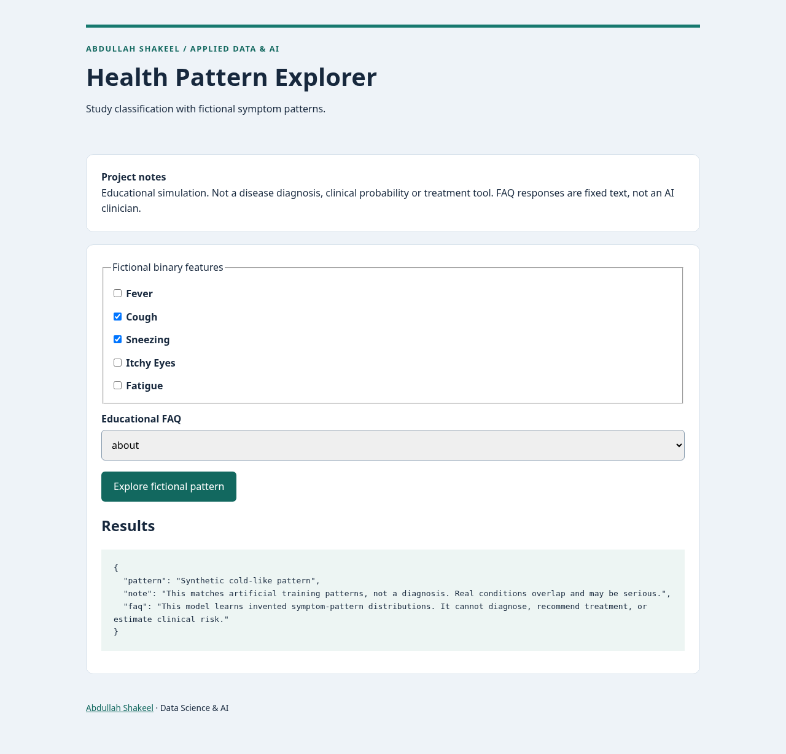

# Health Pattern Explorer

I explore model serving through a Flask API that classifies synthetic symptom patterns, with a web interface and Flutter companion source.

**Portfolio project · Abdullah Shakeel**

Python application with reproducible setup, tests and evaluation. See [provenance and scope](PROVENANCE.md) for the implementation background.



## Problem and intended users

Developers studying model serving and mobile/backend integration using fictional cases.

## Features and architecture

Seeded synthetic generator; bounded-depth random forest; input validation; all-zero abstention; local Flask UI and JSON API; fixed educational FAQ; separate Flutter companion scaffold.

```text
Synthetic Bernoulli generator → stratified split → random forest → Python web form or /api/pattern → fictional pattern. Flutter source calls the same API.
```

Binary features and a small forest keep the synthetic experiment reproducible. Fixed FAQ answers constrain educational content. This implementation does not need an external chatbot service or patient data.

## Run locally

Requires Python 3.12. From this repository directory:

```bash
python -m venv .venv
# Windows PowerShell: .venv\Scripts\Activate.ps1
. .venv/bin/activate
pip install -r requirements.txt
python app.py
```

Open http://127.0.0.1:5003 and submit the included fictional example. No credentials or external services are required. `.env.example` documents configuration, but Flask entry points use the documented fixed ports and do not load a .env file. Development servers bind to localhost. They are not production deployments.

## Validate and reproduce evaluation

```bash
pip install -r requirements-dev.txt
python -m pytest -q
python evaluate.py
```

`artifacts/evaluation.json` records the actual preparation run. Read its method alongside every metric. CI runs Python checks and evaluation on push/PR; GitHub Actions validates the application on push and pull requests. Actual desktop and mobile-width browser screenshots are in `artifacts/`. Those screenshots show the Python web interface, not a mobile binary.

## Data and provenance

See data/DATA_CARD.md. All 600 cases use invented distributions, seed 73, without patients, medical records or demographics.

See [PROVENANCE.md](PROVENANCE.md) and [LICENSE-REVIEW.md](LICENSE-REVIEW.md). Newly authored source and fixtures use MIT; dependencies retain their own licenses. No CV numerical achievement is represented as a measured result.

## Limitations and responsible use

Not a diagnosis or a medical device. The three labels describe artificial patterns, not verified diseases. The generator is not a medical source. Duplicate binary patterns can occur across the split. No clinical, subgroup, calibration or prospective validation exists. No treatment guidance is generated. The Flutter companion has not been built or tested; Python web/API validation does not establish mobile readiness.

Inputs are processed in memory; application code does not persist form contents. Standard web-server request metadata may still appear in local logs. Use fictional examples, never confidential employer, applicant, patient or billing information. No authentication or production abuse protection is included; keep this demo local.

## Future improvements

Validate the mobile build in a Flutter environment. For any clinical research, obtain appropriate data permissions, clinician input and independent validation; do not extend this synthetic demo directly into clinical use.

## Repository guide

- `core.py`: data/model or matching logic.
- `app.py`, `templates/`: local web interface.
- `evaluate.py`: reproducible evaluation and method.
- `test_app.py`: functional and boundary validation.
- `.github/workflows/validate.yml`: Python CI definition.
- `artifacts/`: actual results and screenshots.

## Project summary

Built an educational Flask model-serving demo using synthetic symptom patterns, with strict API validation, abstention, a fixed FAQ and an unvalidated Flutter companion scaffold.

## API and Flutter companion

`POST /api/pattern` accepts `{"features":[1,1,0,0,1]}` in the order fever, cough, sneezing, itchy_eyes, fatigue. Each must be integer 0 or 1. Invalid JSON/object/feature inputs return HTTP 400. See [mobile/README.md](mobile/README.md) for source-scaffold status and setup.
